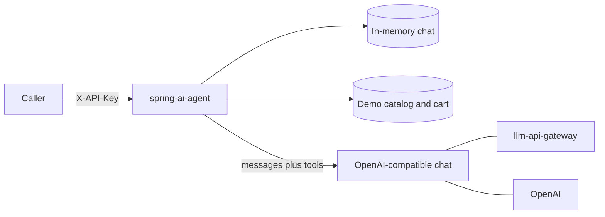
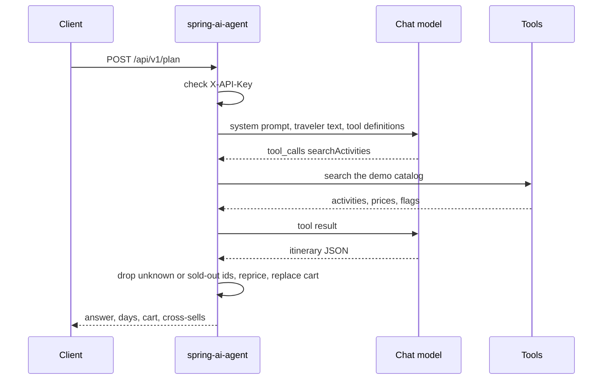

# spring-ai-agent

Portfolio trip-planning agent by Sandeep Vedavyas, senior backend engineer (Kotlin, Spring) in Berlin.

A traveler writes "3 days in Lisbon with kids, mid budget". The agent calls tools, then returns a day-by-day itinerary of bookable activities with catalog prices, a short answer, and a cart. The point of the service is to move a free-text idea toward checkout: pick activities that fit, answer the objection that would abandon the booking, and attach a complement.

This is a demo. The catalog is fictional, written for this repository, and was not scraped. It is not a GetYourGuide product and it is not affiliated with GetYourGuide. There is no live supplier API and no payment capture.

The model call is an OpenAI-compatible HTTP API. The same process can target [llm-api-gateway](https://github.com/sandeepvedavyas/llm-api-gateway), OpenAI, or another compatible gateway by changing `OPENAI_BASE_URL`, `OPENAI_API_KEY`, and `OPENAI_MODEL`.

## Why this agent

A marketplace listing page asks the traveler to already know the city, the category, and which objection matters. Most of them don't. The drop-off is the gap between "a long weekend with the kids" and a cart.

- **Conversion.** The plan is already priced and placed in a session cart. The next step is checkout, not another search.
- **Objection handling.** `summarizeReviews` answers skip-the-line, kid friendly, and rain from the catalog flags and the review text. Each booked stop also carries that reassurance, so a vague model reply cannot hide a bad fit.
- **Cross-sell.** `suggestCrossSell` returns complements in the same city after the hero activity is chosen. The HTTP response includes up to three that are not already on the itinerary.

Prices in the response are recomputed from the catalog. The model can choose an activity id. It cannot set the amount.

## Architecture





The loop above is Spring AI's tool execution inside `ChatClient`. The model does not run the tools. This process does, then sends the tool result back on `POST /v1/chat/completions`. `MessageWindowChatMemory` keeps the user text and the final assistant text for a conversation id. Intermediate tool messages are not stored. That is a current Spring AI limit. A follow-up still sees the itinerary JSON the model already produced.

| Piece | v1 |
| --- | --- |
| Chat | Spring AI `ChatClient` and `OpenAiChatModel` |
| Tools | `@Tool` methods on `ActivityTools` |
| Memory | `MessageWindowChatMemory`, 40 messages, keyed by conversation id |
| Catalog and cart | JSON seed loaded at startup, `ConcurrentHashMap` cart |
| HTTP | Spring MVC, virtual threads, problem details |
| Auth | One `X-API-Key`, compared by SHA-256 digest |

`OPENAI_BASE_URL` is the origin. Spring AI appends `/v1/chat/completions`. A base that already ends in `/v1` is stripped once so the path is not doubled. That matches both `https://api.openai.com` and `https://api.openai.com/v1`, and it matches a gateway origin of `http://localhost:8081` or `http://localhost:8081/v1`.

## Run in five minutes

Requires Java 21 for the Gradle path, or Docker for the image path. No provider key is baked into the repo. Copy `.env.example` and put secrets only in your environment.

Spring does not read `.env` by itself. `source` exports it. The defaults in `application.yml` match a local demo: API key `local-dev-key`, model `gpt-4o-mini`, upstream key placeholder `local-demo`. With those defaults the process boots and `/actuator/health` is green. A plan call reaches whatever `OPENAI_BASE_URL` points at, and a placeholder key is rejected by a real provider.

### OpenAI

```bash
cp .env.example .env
set -a && source .env && set +a
export OPENAI_API_KEY=replace-me
./gradlew bootRun
```

### Sibling gateway

Run [llm-api-gateway](https://github.com/sandeepvedavyas/llm-api-gateway) on port 8081 with a caller key and an upstream provider key. Point this agent at the gateway origin. The model name has to be one the gateway will route.

```bash
export AGENT_API_KEY=local-dev-key
export OPENAI_BASE_URL=http://localhost:8081
export OPENAI_API_KEY=replace-me
export OPENAI_MODEL=gpt-4o-mini
./gradlew bootRun
```

`OPENAI_API_KEY` here is the gateway caller key, not the provider key. The gateway holds the provider key.

From Docker, the gateway on the host is `http://host.docker.internal:8081`. Compose adds that host name.

### Docker

```bash
cp .env.example .env
docker compose up --build
```

`GET /` lists the routes and does not require a key. `GET /actuator/health` and `GET /actuator/info` are open. Everything else, including Prometheus and the plan API, requires `X-API-Key`.

## Smoke curls

```bash
export AGENT_API_KEY=local-dev-key
export BASE=http://localhost:8080
```

Plan a trip:

```bash
curl -sS -X POST "$BASE/api/v1/plan" \
  -H "X-API-Key: $AGENT_API_KEY" \
  -H "Content-Type: application/json" \
  -d '{
    "message": "3 days in Lisbon with kids, mid budget",
    "sessionId": "demo-1",
    "conversationId": "demo-1"
  }'
```

A grounded response looks like this. `model` is whatever the upstream chat call returned. Amounts are the catalog's, not the model's. `toolsUsed` is the tool names this process actually ran.

```json
{
  "sessionId": "demo-1",
  "conversationId": "demo-1",
  "answer": "Three family days in Lisbon: the aquarium if it rains, Belém Tower with skip-the-line entry, and a pastel workshop.",
  "model": "gpt-4o-mini",
  "itinerary": [
    {
      "day": 1,
      "date": "2026-06-12",
      "city": "Lisbon",
      "activities": [
        {
          "activityId": "lis-oceanario",
          "title": "Oceanário Family Ticket",
          "category": "family",
          "date": "2026-06-12",
          "participants": 2,
          "pricePerPerson": 28.00,
          "totalPrice": 56.00,
          "currency": "EUR",
          "durationMinutes": 120,
          "kidFriendly": true,
          "skipTheLine": true,
          "rainFriendly": true,
          "rationale": "Rain-proof and built for kids.",
          "reassurance": "Skip-the-line: included. Travelers do not join the general entry queue. Kid friendly: yes. Families are a normal part of this activity. Rain: covered or indoors, so a wet forecast does not cancel the plan."
        }
      ]
    }
  ],
  "cart": {
    "sessionId": "demo-1",
    "items": [
      {
        "activityId": "lis-oceanario",
        "title": "Oceanário Family Ticket",
        "city": "Lisbon",
        "date": "2026-06-12",
        "participants": 2,
        "pricePerPerson": 28.00,
        "total": 56.00,
        "currency": "EUR"
      }
    ],
    "total": 56.00,
    "currency": "EUR"
  },
  "crossSells": [],
  "objectionNotes": [],
  "toolsUsed": ["searchActivities", "checkAvailability", "getPrice", "summarizeReviews"],
  "warnings": [],
  "disclaimer": "Demo catalog only. Not affiliated with GetYourGuide. Activities, prices, availability, and reviews are fictional and were not scraped."
}
```

The cart in a live call contains one line per dated stop. The snippet above only shows the shape of a stop. Parties of four or more are 10 percent off the per-person price. `getPrice` and the response both use that rule.

Continue the same conversation:

```bash
curl -sS -X POST "$BASE/api/v1/chat" \
  -H "X-API-Key: $AGENT_API_KEY" \
  -H "Content-Type: application/json" \
  -d '{
    "message": "Swap day 2 for something indoors if it rains.",
    "sessionId": "demo-1",
    "conversationId": "demo-1"
  }'
```

`/api/v1/plan` and `/api/v1/chat` share the agent. Plan asks for a full itinerary. Chat keeps the conversation id and asks the model to update the plan when the traveler changes it. Omit `sessionId` or `conversationId` and the service mints one and returns it. `participants` is optional. "2 adults and 2 kids" is read as 4. "3 days" is not a party size. The default is 2.

Read the cart without another model call:

```bash
curl -sS "$BASE/api/v1/sessions/demo-1/cart" \
  -H "X-API-Key: $AGENT_API_KEY"
```

Other calls:

```bash
curl -sS "$BASE/"
curl -sS "$BASE/actuator/health"
curl -sS "$BASE/actuator/prometheus" -H "X-API-Key: $AGENT_API_KEY"
```

Missing or wrong API keys get `401` with `WWW-Authenticate: ApiKey` and a problem-details body. A blank `message` is `400`. A session id outside `[A-Za-z0-9._-]{1,80}` is `400`. Upstream timeouts are `504`. Other upstream failures are `502`. The response does not include the prompt or the upstream body.

`X-Request-Id` is echoed, or generated, and written into the MDC key `requestId`. Successful plan calls increment `trip.plan.requests` with `mode` and `outcome`. The traveler message is not logged.

## Tools

| Tool | What it decides |
| --- | --- |
| `searchActivities(city, category, maxPrice, date)` | Up to eight activities. `category` `family` or `kids` keeps kid-friendly stops. `maxPrice` `0` means no cap. A sold-out date is left out. |
| `checkAvailability(activityId, date, participants)` | Remaining places. A listed capacity of 0, or a closed date, is sold out. |
| `getPrice(activityId, participants)` | EUR total. Four or more participants get 10 percent off. |
| `summarizeReviews(activityId)` | Average rating plus skip-the-line, kid friendly, and rain. |
| `suggestCrossSell(bookedActivityId)` | Up to three complements in the same city. |
| `addToCart(sessionId, activityId, date, participants)` | Refuses a bad id, a bad date, a party outside the activity limits, or a sold-out date. |
| `getCart(sessionId)` | Current lines and total. |

Cities in the seed: Lisbon, Barcelona, Berlin, Rome. Aliases `Lisboa`, `Barca`, and `Roma` resolve. Anything else is an error the model can read. The seed has 34 activities, each with reviews and a default capacity of 20. `lis-belem-tower` is sold out on `2026-06-13`. `rom-colosseum-skip` is closed on `2026-12-25`.

After the model returns, the service drops unknown ids and sold-out dates, reprices what remains, and replaces that session's cart with the dated stops. A chat turn that only answers a question leaves the cart alone.

## Tests

`./gradlew build` compiles, tests, and packs the jar. No test calls a paid API.

Unit tests cover the catalog filters, group pricing, sold-out dates, review objections, cross-sell, the tool methods, party-size parsing, JSON extraction, API-key comparison, and base-URL normalization.

`PlanApiIntegrationTest` boots the real MVC stack. OkHttp `MockWebServer` answers `POST /v1/chat/completions`. The first completion is a `tool_calls` response for `searchActivities`. The service runs that tool against the real seed and posts the tool result back. The second completion is itinerary JSON. The test checks the bearer header, the single `/v1` path, the catalog price of 28.00 EUR, the cart total, and a second turn that can only know `TICKET-ALPHA` because chat memory kept the first answer.

## Layout

```
src/main/kotlin/com/sandeepvedavyas/tripagent
  api/          controllers, DTOs, problem details
  auth/         X-API-Key filter and request id
  agent/        prompt, memory-backed ChatClient call, itinerary assembly
  catalog/      seed, pricing, availability, cart
  tools/        Spring AI @Tool methods
  config/       OpenAI client, health, properties
```

## Configuration

| Variable | Purpose | Default |
| --- | --- | --- |
| `AGENT_API_KEY` | `X-API-Key` for this API | `local-dev-key` |
| `OPENAI_BASE_URL` | OpenAI-compatible origin. A trailing `/v1` is stripped. | `https://api.openai.com` |
| `OPENAI_API_KEY` | Upstream bearer token. For the sibling gateway, this is the gateway caller key. | `local-demo` |
| `OPENAI_MODEL` | Chat model name | `gpt-4o-mini` |
| `OPENAI_TIMEOUT` | Upstream read timeout | `30s` |
| `SERVER_PORT` | Listen port | `8080` |

The local default `AGENT_API_KEY` logs a warning at startup. The upstream base URL is logged with userinfo removed. The key itself is not logged. A blank `AGENT_API_KEY` fails closed: every protected request is `401`.

## Design trade-offs

- **The catalog is the source of truth for money and objections.** The model selects ids and writes the rationale. `Pricing` and `summarizeReviews` overwrite the numbers and the skip-the-line, kid, and rain lines. A fluent answer that quotes a made-up price does not change the HTTP total.
- **The cart is replaced from the itinerary, not trusted from `addToCart` alone.** The tool is real and is what the prompt tells the model to call. A model that forgets the tool still leaves a cart, because the service writes one line per dated stop. A follow-up with an empty itinerary does not wipe that cart.
- **In memory, on purpose.** The seed is a classpath JSON file. The cart and the chat window live in the JVM. A restart drops both. `ActivityCatalog` and `TripCart` are the swap points for a database. The HTTP shape does not have to change.
- **One service key.** Comparison is SHA-256 then `MessageDigest.isEqual`, so it does not return early on length. This matches the sibling demo credential. It is not a user directory, not a rotation list, and not Spring Security.
- **MVC and virtual threads, not WebFlux.** The tool loop is a blocking chat call with several upstream round trips. Virtual threads keep that off the platform carrier without a second HTTP stack. The sibling gateway stays on WebFlux because it proxies a stream. This service does not stream.
- **No payment, no supplier hold.** `addToCart` decrements nothing in the seed. Capacity is a fixed map, so two sessions can both "book" the last place. That is acceptable for a demo and wrong for a checkout. A hold would be a separate write with a timeout.
- **Chat memory does not store tool transcripts.** The next turn sees the previous user text and the previous assistant JSON. It does not see the raw tool payload. The catalog is still there to be called again.
- **Retries are short.** `spring.ai.retry.max-attempts` is 2. A failed upstream stays a failed request. The service does not invent an itinerary from the model's priors when the call fails.

## Failure modes

| Situation | Caller sees |
| --- | --- |
| No `X-API-Key`, or wrong key | 401 problem detail |
| Blank `message`, bad JSON, or bad session id | 400 problem detail |
| Upstream read timeout | 504 `The model timed out.` |
| Upstream error, or a response this client cannot parse | 502 `The model call failed.` |
| Model names an id that is not in the seed | 200, id dropped, explanation in `warnings` |
| Model names a sold-out date | 200, stop dropped, explanation in `warnings` |
| Model returns prose instead of JSON | 200, `answer` is that prose, itinerary empty, cart unchanged |

## What is intentionally out of scope

- A real GetYourGuide or supplier API
- Scraping, partner feeds, or a claim of affiliation
- Payment, inventory holds, or a cart that survives a restart
- More than one API key, or a user account
- Token streaming
- Postgres, Redis, or a vector store

A sensible production follow-up is a catalog service with holds, a cart keyed by a signed traveler id, and this process kept as the only component that sees the model.
