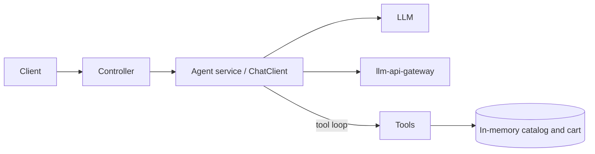
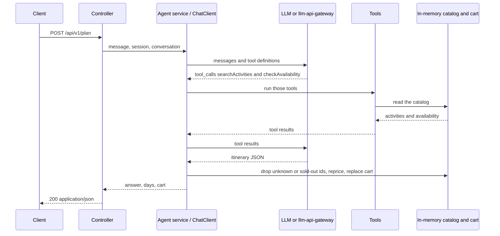

# spring-ai-agent

A Kotlin and Spring Boot 3 trip-planning agent for a B2C experiences marketplace. A traveler writes a free-text request such as "3 days in Lisbon with kids, mid budget". The agent calls tools, then returns a day-by-day itinerary of bookable activities, catalog prices, a short answer, and a session cart.

**This is a demo. It is not affiliated with GetYourGuide.** The catalog, prices, availability, and reviews are fictional and were written for this repository. Nothing was scraped, and there is no live supplier API and no payment capture.

## Business value

The listing page assumes the traveler already knows the city, the category, and which objection matters. Most of them do not, and that gap is where the booking is lost.

- **Conversion.** The reply is already a priced itinerary in a session cart. The next step is checkout, not another search.
- **Objection handling.** Review summaries answer skip-the-line, kid friendly, and rain. Each booked stop carries that reassurance from the catalog, so a fluent sentence cannot hide a bad fit.
- **Cross-sell.** After the hero activity is chosen, the response includes complements in the same city that are not already on the itinerary.

The model may choose activity ids. It does not set the price. Amounts in the HTTP response are recomputed from the seed.

## Architecture



`ChatClient` talks to one OpenAI-compatible origin. That origin is either the model provider or [llm-api-gateway](https://github.com/sandeepvedavyas/llm-api-gateway). Spring AI appends `/v1/chat/completions`. A base URL that already ends in `/v1` is stripped once so the path is not doubled.



`POST /api/v1/chat` uses the same loop and keeps `MessageWindowChatMemory` for the conversation id. The window stores the user text and the final assistant text. It does not store the tool transcript.

## Prerequisites

- Java 21 for Gradle and the jar
- Docker, only if you use the image or Compose
- Python 3, only for `scripts/fake-openai/server.py`

No provider key is stored in the repo.

## How to run

Spring does not read `.env` by itself. Export the variables, or let the defaults in `application.yml` stand. The default API key is `local-dev-key`. The default upstream key is the placeholder `local-demo`, which a real provider will reject.

### Gradle

```bash
export AGENT_API_KEY=local-dev-key
export OPENAI_BASE_URL=https://api.openai.com
export OPENAI_API_KEY=replace-me
export OPENAI_MODEL=gpt-4o-mini
./gradlew bootRun
```

### Jar

```bash
./gradlew bootJar
export AGENT_API_KEY=local-dev-key
export OPENAI_BASE_URL=https://api.openai.com
export OPENAI_API_KEY=replace-me
export OPENAI_MODEL=gpt-4o-mini
java -jar build/libs/spring-ai-agent.jar
```

### Docker

```bash
docker build -t spring-ai-agent .
docker run --rm -p 8080:8080 \
  -e AGENT_API_KEY=local-dev-key \
  -e OPENAI_BASE_URL=https://api.openai.com \
  -e OPENAI_API_KEY=replace-me \
  -e OPENAI_MODEL=gpt-4o-mini \
  spring-ai-agent
```

### docker-compose

```bash
cp .env.example .env
docker compose up --build
```

Compose publishes port 8080. A gateway on the host is reachable as `http://host.docker.internal:8081`.

### Local stub

`scripts/fake-openai/server.py` listens on `127.0.0.1:8099`. The first completion in a turn returns `tool_calls` for `searchActivities` and `checkAvailability`. The follow-up, which carries the tool results, returns itinerary JSON. It answers `Expect: 100-continue` and reads chunked HTTP/1.1 bodies, which is what Spring's JDK client sends.

```bash
python3 scripts/fake-openai/server.py
```

In another shell:

```bash
export AGENT_API_KEY=local-dev-key
export OPENAI_BASE_URL=http://127.0.0.1:8099
export OPENAI_API_KEY=local-demo
export OPENAI_MODEL=gpt-4o-mini
java -jar build/libs/spring-ai-agent.jar
```

### Sibling gateway

Run [llm-api-gateway](https://github.com/sandeepvedavyas/llm-api-gateway) on port 8081. `OPENAI_API_KEY` is the gateway caller key. The gateway holds the provider key.

```bash
export AGENT_API_KEY=local-dev-key
export OPENAI_BASE_URL=http://localhost:8081
export OPENAI_API_KEY=replace-me
export OPENAI_MODEL=gpt-4o-mini
./gradlew bootRun
```

`GET /`, `GET /actuator/health`, and `GET /actuator/info` are open. Every other route, including Prometheus and the plan API, requires `X-API-Key`.

## Configuration

| Variable | Purpose | Default |
| --- | --- | --- |
| `AGENT_API_KEY` | Value of the `X-API-Key` header | `local-dev-key` |
| `OPENAI_BASE_URL` | OpenAI-compatible origin. A trailing `/v1` is stripped. | `https://api.openai.com` |
| `OPENAI_API_KEY` | Upstream bearer token. For the gateway, this is the caller key. | `local-demo` |
| `OPENAI_MODEL` | Chat model name | `gpt-4o-mini` |
| `OPENAI_TIMEOUT` | Upstream read timeout | `30s` |
| `SERVER_PORT` | Listen port | `8080` |

A blank `AGENT_API_KEY` fails closed. The local default logs a warning at startup. The upstream base URL is logged with any userinfo removed. The key is not logged.

## Testing

`./gradlew clean build` was run on Java 21. The test task ran 28 tests, with 0 failures, 0 errors, and 0 skipped. No test calls a paid API. The integration test uses OkHttp `MockWebServer`. The class times below are the `time` attributes from that run's JUnit XML.

| Class | Tests | Failures | Errors | Skipped | Time (s) |
| --- | ---: | ---: | ---: | ---: | ---: |
| `ActivityCatalogTest` | 6 | 0 | 0 | 0 | 0.038 |
| `ActivityToolsTest` | 4 | 0 | 0 | 0 | 0.033 |
| `ApiKeyVerifierTest` | 2 | 0 | 0 | 0 | 0.001 |
| `ItineraryAssemblerTest` | 2 | 0 | 0 | 0 | 0.092 |
| `ModelPlanParserTest` | 2 | 0 | 0 | 0 | 0.052 |
| `OpenAiBaseUrlsTest` | 3 | 0 | 0 | 0 | 0.001 |
| `ParticipantHintTest` | 4 | 0 | 0 | 0 | 0.005 |
| `PlanApiIntegrationTest` | 5 | 0 | 0 | 0 | 1.481 |
| **Total** | **28** | **0** | **0** | **0** | |

GitHub Actions runs `./gradlew build` on Java 21.

## Sample API calls

These responses were captured from `java -jar build/libs/spring-ai-agent.jar` with `scripts/fake-openai/server.py` as the model. They are not output from a paid LLM. `diskSpace` figures and `requestId` values are from that capture and will differ on another machine. JSON below is the response body, pretty-printed.

```bash
export AGENT_API_KEY=local-dev-key
export BASE=http://127.0.0.1:8080
```

### GET /actuator/health

Status **200**. No API key.

```bash
curl -sS "$BASE/actuator/health"
```

```json
{
  "status": "UP",
  "groups": [
    "liveness",
    "readiness"
  ],
  "components": {
    "catalog": {
      "status": "UP",
      "details": {
        "activities": 34,
        "cities": [
          "Barcelona",
          "Berlin",
          "Lisbon",
          "Rome"
        ],
        "disclaimer": "Demo catalog only. Not affiliated with GetYourGuide. Activities, prices, availability, and reviews are fictional and were not scraped."
      }
    },
    "diskSpace": {
      "status": "UP",
      "details": {
        "total": 271966244864,
        "free": 263263588352,
        "threshold": 10485760,
        "path": "/workspace/.",
        "exists": true
      }
    },
    "livenessState": {
      "status": "UP"
    },
    "ping": {
      "status": "UP"
    },
    "readinessState": {
      "status": "UP"
    },
    "ssl": {
      "status": "UP",
      "details": {
        "validChains": [],
        "invalidChains": []
      }
    }
  }
}
```

### GET /actuator/info

Status **200**. No API key.

```bash
curl -sS "$BASE/actuator/info"
```

```json
{
  "app": {
    "name": "spring-ai-agent",
    "description": "Demo trip-planning agent. Not affiliated with GetYourGuide.",
    "version": "0.1.0"
  }
}
```

### POST /api/v1/plan

Status **200**. Message: `3 days in Lisbon with kids, mid budget`.

```bash
curl -sS -X POST "$BASE/api/v1/plan" \
  -H "X-API-Key: $AGENT_API_KEY" \
  -H "Content-Type: application/json" \
  -d '{"message":"3 days in Lisbon with kids, mid budget","sessionId":"plan-lisbon","conversationId":"plan-lisbon"}'
```

```json
{
  "sessionId": "plan-lisbon",
  "conversationId": "plan-lisbon",
  "answer": "Three family days in Lisbon: the aquarium if the weather turns, Belém Tower with skip-the-line entry, and a pastel workshop.",
  "model": "gpt-4o-mini",
  "itinerary": [
    {
      "day": 1,
      "date": "2026-11-21",
      "city": "Lisbon",
      "activities": [
        {
          "activityId": "lis-oceanario",
          "title": "Oceanário Family Ticket",
          "category": "family",
          "date": "2026-11-21",
          "participants": 2,
          "pricePerPerson": 28.0,
          "totalPrice": 56.0,
          "currency": "EUR",
          "durationMinutes": 120,
          "kidFriendly": true,
          "skipTheLine": true,
          "rainFriendly": true,
          "rationale": "Rain-proof and built for kids.",
          "reassurance": "Skip-the-line: included. Travelers do not join the general entry queue. Kid friendly: yes. Families are a normal part of this activity. Rain: covered or indoors, so a wet forecast does not cancel the plan."
        }
      ]
    },
    {
      "day": 2,
      "date": "2026-11-22",
      "city": "Lisbon",
      "activities": [
        {
          "activityId": "lis-belem-tower",
          "title": "Belém Tower Skip-the-Line",
          "category": "sightseeing",
          "date": "2026-11-22",
          "participants": 2,
          "pricePerPerson": 22.0,
          "totalPrice": 44.0,
          "currency": "EUR",
          "durationMinutes": 75,
          "kidFriendly": true,
          "skipTheLine": true,
          "rainFriendly": false,
          "rationale": "Skip-the-line entry before the crowds.",
          "reassurance": "Skip-the-line: included. Travelers do not join the general entry queue. Kid friendly: yes. Families are a normal part of this activity. Rain: outdoors. Book a museum or food stop as the wet-weather backup."
        }
      ]
    },
    {
      "day": 3,
      "date": "2026-11-23",
      "city": "Lisbon",
      "activities": [
        {
          "activityId": "lis-pastel-workshop",
          "title": "Pastel de Nata Workshop",
          "category": "food",
          "date": "2026-11-23",
          "participants": 2,
          "pricePerPerson": 45.0,
          "totalPrice": 90.0,
          "currency": "EUR",
          "durationMinutes": 90,
          "kidFriendly": true,
          "skipTheLine": false,
          "rainFriendly": true,
          "rationale": "A hands-on food stop that still fits a mid budget.",
          "reassurance": "Skip-the-line: not included. Expect the regular entry line. Kid friendly: yes. Families are a normal part of this activity. Rain: covered or indoors, so a wet forecast does not cancel the plan."
        }
      ]
    }
  ],
  "cart": {
    "sessionId": "plan-lisbon",
    "items": [
      {
        "activityId": "lis-oceanario",
        "title": "Oceanário Family Ticket",
        "city": "Lisbon",
        "date": "2026-11-21",
        "participants": 2,
        "pricePerPerson": 28.0,
        "total": 56.0,
        "currency": "EUR"
      },
      {
        "activityId": "lis-belem-tower",
        "title": "Belém Tower Skip-the-Line",
        "city": "Lisbon",
        "date": "2026-11-22",
        "participants": 2,
        "pricePerPerson": 22.0,
        "total": 44.0,
        "currency": "EUR"
      },
      {
        "activityId": "lis-pastel-workshop",
        "title": "Pastel de Nata Workshop",
        "city": "Lisbon",
        "date": "2026-11-23",
        "participants": 2,
        "pricePerPerson": 45.0,
        "total": 90.0,
        "currency": "EUR"
      }
    ],
    "total": 190.0,
    "currency": "EUR"
  },
  "crossSells": [
    {
      "activityId": "lis-tram-28",
      "title": "Tram 28 Hills Ride",
      "city": "Lisbon",
      "category": "sightseeing",
      "pricePerPerson": 27.0,
      "currency": "EUR",
      "kidFriendly": true,
      "skipTheLine": false,
      "rainFriendly": false,
      "durationMinutes": 90
    },
    {
      "activityId": "lis-tile-museum",
      "title": "National Tile Museum",
      "city": "Lisbon",
      "category": "museum",
      "pricePerPerson": 14.0,
      "currency": "EUR",
      "kidFriendly": true,
      "skipTheLine": false,
      "rainFriendly": true,
      "durationMinutes": 80
    }
  ],
  "objectionNotes": [
    "The aquarium stays open if it rains, and the tower ticket skips the line."
  ],
  "toolsUsed": [
    "searchActivities",
    "checkAvailability"
  ],
  "warnings": [],
  "disclaimer": "Demo catalog only. Not affiliated with GetYourGuide. Activities, prices, availability, and reviews are fictional and were not scraped."
}
```

### POST /api/v1/chat, first turn

Status **200**. Same trip, conversation `chat-lisbon`.

```bash
curl -sS -X POST "$BASE/api/v1/chat" \
  -H "X-API-Key: $AGENT_API_KEY" \
  -H "Content-Type: application/json" \
  -d '{"message":"3 days in Lisbon with kids, mid budget","sessionId":"chat-lisbon","conversationId":"chat-lisbon"}'
```

```json
{
  "sessionId": "chat-lisbon",
  "conversationId": "chat-lisbon",
  "answer": "Three family days in Lisbon: the aquarium if the weather turns, Belém Tower with skip-the-line entry, and a pastel workshop.",
  "model": "gpt-4o-mini",
  "itinerary": [
    {
      "day": 1,
      "date": "2026-11-21",
      "city": "Lisbon",
      "activities": [
        {
          "activityId": "lis-oceanario",
          "title": "Oceanário Family Ticket",
          "category": "family",
          "date": "2026-11-21",
          "participants": 2,
          "pricePerPerson": 28.0,
          "totalPrice": 56.0,
          "currency": "EUR",
          "durationMinutes": 120,
          "kidFriendly": true,
          "skipTheLine": true,
          "rainFriendly": true,
          "rationale": "Rain-proof and built for kids.",
          "reassurance": "Skip-the-line: included. Travelers do not join the general entry queue. Kid friendly: yes. Families are a normal part of this activity. Rain: covered or indoors, so a wet forecast does not cancel the plan."
        }
      ]
    },
    {
      "day": 2,
      "date": "2026-11-22",
      "city": "Lisbon",
      "activities": [
        {
          "activityId": "lis-belem-tower",
          "title": "Belém Tower Skip-the-Line",
          "category": "sightseeing",
          "date": "2026-11-22",
          "participants": 2,
          "pricePerPerson": 22.0,
          "totalPrice": 44.0,
          "currency": "EUR",
          "durationMinutes": 75,
          "kidFriendly": true,
          "skipTheLine": true,
          "rainFriendly": false,
          "rationale": "Skip-the-line entry before the crowds.",
          "reassurance": "Skip-the-line: included. Travelers do not join the general entry queue. Kid friendly: yes. Families are a normal part of this activity. Rain: outdoors. Book a museum or food stop as the wet-weather backup."
        }
      ]
    },
    {
      "day": 3,
      "date": "2026-11-23",
      "city": "Lisbon",
      "activities": [
        {
          "activityId": "lis-pastel-workshop",
          "title": "Pastel de Nata Workshop",
          "category": "food",
          "date": "2026-11-23",
          "participants": 2,
          "pricePerPerson": 45.0,
          "totalPrice": 90.0,
          "currency": "EUR",
          "durationMinutes": 90,
          "kidFriendly": true,
          "skipTheLine": false,
          "rainFriendly": true,
          "rationale": "A hands-on food stop that still fits a mid budget.",
          "reassurance": "Skip-the-line: not included. Expect the regular entry line. Kid friendly: yes. Families are a normal part of this activity. Rain: covered or indoors, so a wet forecast does not cancel the plan."
        }
      ]
    }
  ],
  "cart": {
    "sessionId": "chat-lisbon",
    "items": [
      {
        "activityId": "lis-oceanario",
        "title": "Oceanário Family Ticket",
        "city": "Lisbon",
        "date": "2026-11-21",
        "participants": 2,
        "pricePerPerson": 28.0,
        "total": 56.0,
        "currency": "EUR"
      },
      {
        "activityId": "lis-belem-tower",
        "title": "Belém Tower Skip-the-Line",
        "city": "Lisbon",
        "date": "2026-11-22",
        "participants": 2,
        "pricePerPerson": 22.0,
        "total": 44.0,
        "currency": "EUR"
      },
      {
        "activityId": "lis-pastel-workshop",
        "title": "Pastel de Nata Workshop",
        "city": "Lisbon",
        "date": "2026-11-23",
        "participants": 2,
        "pricePerPerson": 45.0,
        "total": 90.0,
        "currency": "EUR"
      }
    ],
    "total": 190.0,
    "currency": "EUR"
  },
  "crossSells": [
    {
      "activityId": "lis-tram-28",
      "title": "Tram 28 Hills Ride",
      "city": "Lisbon",
      "category": "sightseeing",
      "pricePerPerson": 27.0,
      "currency": "EUR",
      "kidFriendly": true,
      "skipTheLine": false,
      "rainFriendly": false,
      "durationMinutes": 90
    },
    {
      "activityId": "lis-tile-museum",
      "title": "National Tile Museum",
      "city": "Lisbon",
      "category": "museum",
      "pricePerPerson": 14.0,
      "currency": "EUR",
      "kidFriendly": true,
      "skipTheLine": false,
      "rainFriendly": true,
      "durationMinutes": 80
    }
  ],
  "objectionNotes": [
    "The aquarium stays open if it rains, and the tower ticket skips the line."
  ],
  "toolsUsed": [
    "searchActivities",
    "checkAvailability"
  ],
  "warnings": [],
  "disclaimer": "Demo catalog only. Not affiliated with GetYourGuide. Activities, prices, availability, and reviews are fictional and were not scraped."
}
```

### POST /api/v1/chat, second turn

Status **200**. Same `conversationId`. Message: `Swap day 2 for something indoor if it rains.`

```bash
curl -sS -X POST "$BASE/api/v1/chat" \
  -H "X-API-Key: $AGENT_API_KEY" \
  -H "Content-Type: application/json" \
  -d '{"message":"Swap day 2 for something indoor if it rains.","sessionId":"chat-lisbon","conversationId":"chat-lisbon"}'
```

```json
{
  "sessionId": "chat-lisbon",
  "conversationId": "chat-lisbon",
  "answer": "Day 2 is now the National Tile Museum, which is indoors if it rains. The aquarium and the pastel workshop stay on the Lisbon plan.",
  "model": "gpt-4o-mini",
  "itinerary": [
    {
      "day": 1,
      "date": "2026-11-21",
      "city": "Lisbon",
      "activities": [
        {
          "activityId": "lis-oceanario",
          "title": "Oceanário Family Ticket",
          "category": "family",
          "date": "2026-11-21",
          "participants": 2,
          "pricePerPerson": 28.0,
          "totalPrice": 56.0,
          "currency": "EUR",
          "durationMinutes": 120,
          "kidFriendly": true,
          "skipTheLine": true,
          "rainFriendly": true,
          "rationale": "Still the kid-friendly indoor start.",
          "reassurance": "Skip-the-line: included. Travelers do not join the general entry queue. Kid friendly: yes. Families are a normal part of this activity. Rain: covered or indoors, so a wet forecast does not cancel the plan."
        }
      ]
    },
    {
      "day": 2,
      "date": "2026-11-22",
      "city": "Lisbon",
      "activities": [
        {
          "activityId": "lis-tile-museum",
          "title": "National Tile Museum",
          "category": "museum",
          "date": "2026-11-22",
          "participants": 2,
          "pricePerPerson": 14.0,
          "totalPrice": 28.0,
          "currency": "EUR",
          "durationMinutes": 80,
          "kidFriendly": true,
          "skipTheLine": false,
          "rainFriendly": true,
          "rationale": "Swap the outdoor tower for a covered museum if it rains.",
          "reassurance": "Skip-the-line: not included. Expect the regular entry line. Kid friendly: yes. Families are a normal part of this activity. Rain: covered or indoors, so a wet forecast does not cancel the plan."
        }
      ]
    },
    {
      "day": 3,
      "date": "2026-11-23",
      "city": "Lisbon",
      "activities": [
        {
          "activityId": "lis-pastel-workshop",
          "title": "Pastel de Nata Workshop",
          "category": "food",
          "date": "2026-11-23",
          "participants": 2,
          "pricePerPerson": 45.0,
          "totalPrice": 90.0,
          "currency": "EUR",
          "durationMinutes": 90,
          "kidFriendly": true,
          "skipTheLine": false,
          "rainFriendly": true,
          "rationale": "The workshop is indoors and still on the mid budget.",
          "reassurance": "Skip-the-line: not included. Expect the regular entry line. Kid friendly: yes. Families are a normal part of this activity. Rain: covered or indoors, so a wet forecast does not cancel the plan."
        }
      ]
    }
  ],
  "cart": {
    "sessionId": "chat-lisbon",
    "items": [
      {
        "activityId": "lis-oceanario",
        "title": "Oceanário Family Ticket",
        "city": "Lisbon",
        "date": "2026-11-21",
        "participants": 2,
        "pricePerPerson": 28.0,
        "total": 56.0,
        "currency": "EUR"
      },
      {
        "activityId": "lis-tile-museum",
        "title": "National Tile Museum",
        "city": "Lisbon",
        "date": "2026-11-22",
        "participants": 2,
        "pricePerPerson": 14.0,
        "total": 28.0,
        "currency": "EUR"
      },
      {
        "activityId": "lis-pastel-workshop",
        "title": "Pastel de Nata Workshop",
        "city": "Lisbon",
        "date": "2026-11-23",
        "participants": 2,
        "pricePerPerson": 45.0,
        "total": 90.0,
        "currency": "EUR"
      }
    ],
    "total": 174.0,
    "currency": "EUR"
  },
  "crossSells": [
    {
      "activityId": "lis-belem-tower",
      "title": "Belém Tower Skip-the-Line",
      "city": "Lisbon",
      "category": "sightseeing",
      "pricePerPerson": 22.0,
      "currency": "EUR",
      "kidFriendly": true,
      "skipTheLine": true,
      "rainFriendly": false,
      "durationMinutes": 75
    }
  ],
  "objectionNotes": [
    "Day 2 is indoors, so rain does not cancel it."
  ],
  "toolsUsed": [
    "searchActivities",
    "checkAvailability"
  ],
  "warnings": [],
  "disclaimer": "Demo catalog only. Not affiliated with GetYourGuide. Activities, prices, availability, and reviews are fictional and were not scraped."
}
```

### GET /api/v1/sessions/chat-lisbon/cart

Status **200**. This is the cart after the second chat turn.

```bash
curl -sS "$BASE/api/v1/sessions/chat-lisbon/cart" \
  -H "X-API-Key: $AGENT_API_KEY"
```

```json
{
  "sessionId": "chat-lisbon",
  "items": [
    {
      "activityId": "lis-oceanario",
      "title": "Oceanário Family Ticket",
      "city": "Lisbon",
      "date": "2026-11-21",
      "participants": 2,
      "pricePerPerson": 28.0,
      "total": 56.0,
      "currency": "EUR"
    },
    {
      "activityId": "lis-tile-museum",
      "title": "National Tile Museum",
      "city": "Lisbon",
      "date": "2026-11-22",
      "participants": 2,
      "pricePerPerson": 14.0,
      "total": 28.0,
      "currency": "EUR"
    },
    {
      "activityId": "lis-pastel-workshop",
      "title": "Pastel de Nata Workshop",
      "city": "Lisbon",
      "date": "2026-11-23",
      "participants": 2,
      "pricePerPerson": 45.0,
      "total": 90.0,
      "currency": "EUR"
    }
  ],
  "total": 174.0,
  "currency": "EUR"
}
```

### POST /api/v1/plan without X-API-Key

Status **401**.

```bash
curl -sS -X POST "$BASE/api/v1/plan" \
  -H "Content-Type: application/json" \
  -d '{"message":"3 days in Lisbon with kids, mid budget"}'
```

```json
{
  "type": "about:blank",
  "title": "Unauthorized",
  "status": 401,
  "detail": "Missing or invalid API key",
  "requestId": "cb15abb7-8b0f-4fbb-b594-90fc2ccf2ff2"
}
```

### POST /api/v1/plan with a blank message

Status **400**.

```bash
curl -sS -X POST "$BASE/api/v1/plan" \
  -H "X-API-Key: $AGENT_API_KEY" \
  -H "Content-Type: application/json" \
  -d '{"message":"  "}'
```

```json
{
  "type": "about:blank",
  "title": "Bad Request",
  "status": 400,
  "detail": "message must not be blank",
  "instance": "/api/v1/plan",
  "requestId": "98938d32-fb22-4c91-9be8-61f3a1172ded"
}
```

## Project structure

```
.
├── Dockerfile
├── docker-compose.yml
├── build.gradle.kts
├── settings.gradle.kts
├── gradle.properties
├── gradlew
├── scripts/fake-openai/server.py
├── src/main/kotlin/com/sandeepvedavyas/tripagent
│   ├── TripAgentApplication.kt
│   ├── api/                 controllers, DTOs, problem details
│   ├── auth/                X-API-Key filter and request id
│   ├── agent/               prompt, ChatClient call, itinerary assembly
│   ├── catalog/             seed, pricing, availability, cart
│   ├── config/              OpenAI client, health, properties
│   ├── domain/
│   └── tools/               Spring AI @Tool methods
├── src/main/resources
│   ├── application.yml
│   └── catalog/activities.json
└── src/test/kotlin/com/sandeepvedavyas/tripagent
    ├── agent/
    ├── api/PlanApiIntegrationTest.kt
    ├── auth/
    ├── catalog/
    ├── config/
    └── tools/
```
